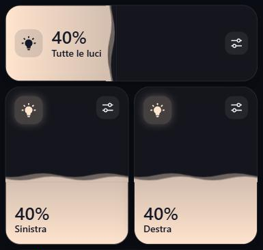

# Light Slider Card

A Home Assistant dashboard card where the whole card is the brightness slider for one light. The fill takes the light's current colour and has an animated wave on its surface. It works vertically or horizontally.



- **Drag** up/down (or left/right) to set the brightness. Dragging to the very bottom turns the light off.
- **Tap** to toggle the light.
- **Tune button** opens Home Assistant's more-info dialog for colour and colour temperature.
- Text and icons switch to a dark colour as the fill covers them, so they stay readable.
- Small animations: press feedback, a springy fill, an icon glow that follows the brightness, and a percentage that counts to its new value. All of them turn off when the device asks for reduced motion.
- Visual editor support, so every option can be changed from the dashboard UI.
- Sized for the sections view: 6 columns x 4 rows when vertical, full width x 2 rows when horizontal. You can change the size from the Layout tab.

No dependencies: a single JavaScript file.

## Install

### HACS

1. HACS → three-dot menu → **Custom repositories**.
2. Add `https://github.com/XenSide/light-slider-card` with type **Dashboard**.
3. Install **Light Slider Card** and reload the browser.

### Manual

1. Copy `light-slider-card.js` to `/config/www/`.
2. Settings → Dashboards → three-dot menu → **Resources** → add `/local/light-slider-card.js?v=1` as a **JavaScript module**.
3. Reload the browser. When you update the file, raise the `?v=` number, otherwise browsers and the Companion app keep the old copy.

## Configuration

| Option | Default | Description |
|---|---|---|
| `entity` | required | A `light.*` entity |
| `name` | friendly name | Text shown on the card |
| `orientation` | `vertical` | `vertical` (fills bottom to top) or `horizontal` (fills left to right) |
| `wave` | `true` | Animated wave on the fill's surface |

```yaml
type: custom:light-slider-card
entity: light.living_room
name: Living room
orientation: horizontal
wave: true
```

## Notes

- The card's own labels ("Spenta", "Non disponibile") and the editor labels are in Italian.
- On a touchscreen, a vertical swipe that starts on a vertical card moves the slider, not the page.

## License

MIT
